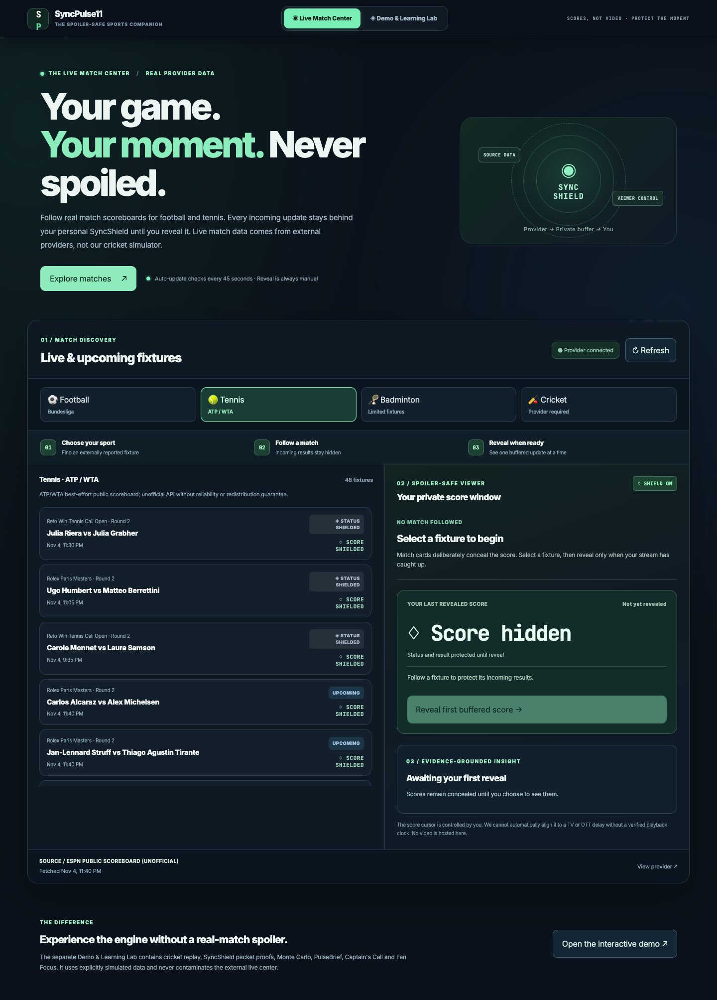
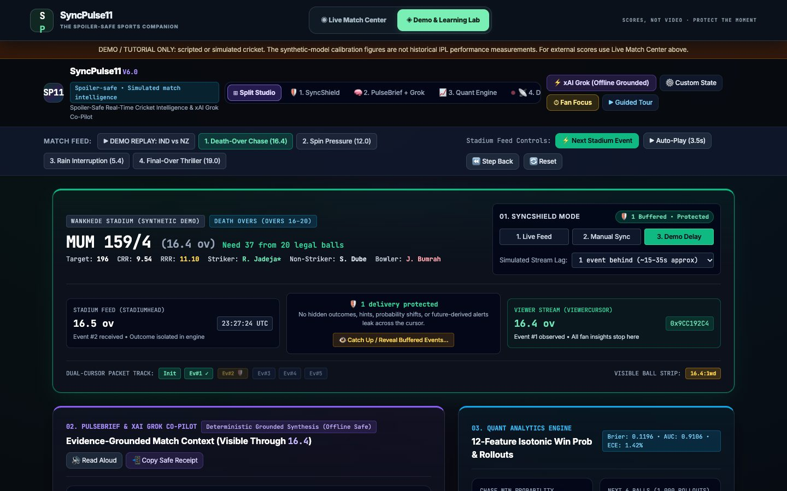

<div align="center">

# SyncPulse11

### Stay with the match. Not ahead of it.

**A spoiler-conscious, multi-sport second-screen companion for fans watching delayed live broadcasts.**

[](https://github.com/Vinayak150/SyncPulse/actions/workflows/ci.yml)


**[Open live application](https://syncpulse11-fde-demo.onrender.com)** · **[Explore cricket Demo Lab](https://syncpulse11-fde-demo.onrender.com/#demo)** · **[Architecture](#architecture)** · **[Testing](#testing)**

</div>



> **Product status:** Working FDE internship prototype, not a commercially licensed live-data or video platform. The Live Match Center uses external sports-score sources. The separate cricket Demo Lab uses scripted/synthetic events. Source availability and permitted uses depend on each provider.

## The problem

An OTT broadcast may lag behind external score feeds. A companion app that automatically refreshes a result can disclose a wicket, goal, decisive set, or final outcome **before the fan sees that moment on the screen**. Avoiding all sports information defeats the purpose of using a second screen.

**SyncPulse11 lets the fan choose when an externally observed score becomes visible.** Provider snapshots are buffered and revealed sequentially, while the already revealed scoreboard and explanation remain unchanged.

## What you can do

| Experience | Fan value | What's actually implemented |
| --- | --- | --- |
| **Live Match Center** | Follow externally reported fixtures without an automatic score reveal | Football and tennis scoreboards, provider metadata, manually revealed FIFO snapshots, factual source-grounded updates |
| **Sports selection** | Discover matches across sports | Bundesliga football; ATP/WTA tennis; limited badminton fixture lookup; optional credential-dependent cricket feed |
| **Demo & Learning Lab** | Experience advanced delivery-level spoiler protection | Curated/simulated cricket match, viewer/stadium cursors, PulseBrief, Captain's Call, Fan Focus, Monte Carlo and tactical graphs |
| **Fan Focus** | Recover after an ad break without skipping unseen events | Watch-position bookmark, timer, visible-only recap, opt-in speech, copyable spoiler-safe receipt |

### 1. Discover a match

Use **Live Match Center** (the default home page) and choose your sport. Actual source-reported fixtures appear with **scores and terminal status concealed**.

### 2. Follow without revealing

Select a fixture. The app polls its provider approximately every 45 seconds and buffers changed score snapshots in first-in, first-out order, rather than pushing updates directly into the visible scoreboard. A server-side cache reduces duplicate upstream requests.

### 3. Reveal on your terms

Press **Reveal** whenever the broadcast catches up. One buffered snapshot becomes visible at a time. Contextual explanations describe only already-revealed source differences, without inventing rallies, goals, or point-by-point events.

> **Important trust boundary:** The Live Match Center shields information **in the UI**. The provider's response JSON still reaches the browser and can be inspected in developer tools. Automatic alignment to an OTT stream is not implemented. Network-level confidentiality would require a trusted per-viewer server-side release system and playback-clock integration.

## Two distinct experiences

### Live Match Center

The production landing page connects to external providers and is transparent about unavailable or incomplete coverage. **It is a score companion, not a video stream.**

| Sport | Provider | Implemented coverage | Reality check |
| --- | --- | --- | --- |
| ⚽ Football | [OpenLigaDB](https://www.openligadb.de/) | Bundesliga match records, schedules, reported scores and goal events | No-key public API; limited to supported leagues |
| 🎾 Tennis | [ESPN tennis scoreboards](https://www.espn.com/tennis/) | ATP/WTA matches, set scores and upstream status | Public **unofficial/undocumented** JSON endpoint; no uptime or redistribution guarantee |
| 🏸 Badminton | [TheSportsDB](https://www.thesportsdb.com/) | Partial fixture discovery | Free source is **not** a verified live-rally feed; may return no fixtures |
| 🏏 Cricket | [CricAPI](https://www.cricapi.com/) | Match summaries if authorized key is configured | Requires `CRICAPI_KEY`; not a verified ball-by-ball commentary source |

A provider outage or missing coverage is shown as such. **Simulated demo matches are never used to fill gaps in live data.**

### Cricket Demo & Learning Lab



Open **[Demo & Learning Lab](https://syncpulse11-fde-demo.onrender.com/#demo)** to explore the event-level engine without needing a licensed live delivery feed.

- **SyncShield:** Two event positions distinguish the latest observed stadium event from the delivery the viewer has watched.
- **PulseBrief:** Deterministic, evidence-grounded explanations over the viewer-visible event prefix.
- **Captain's Call:** Predictions and challenge outcomes gated by the viewer's progress.
- **Fan Focus:** Ad-break bookmark, catch-up summary, opt-in speech and spoiler-safe receipt.
- **Quant and graph workspaces:** Illustrative win-probability estimates, Monte Carlo simulation, and JavaScript-built network diagrams.
- **Session-isolated scorer and SSE:** Separate browser demo sessions with streaming transport, reconnect and reset handling.

The cricket replay and simulated stream **are not live sports data**.

## Architecture

```text
                       EXTERNAL PROVIDER SCORES
             OpenLigaDB · ESPN Tennis · TheSportsDB
                           · optional CricAPI
                                  │
                       Provider adapters (Node)
                normalize · timeout · cache · de-duplicate
                                  │
                         /api/sports/matches
                                  │
                          LIVE MATCH CENTER
                   hidden incoming score snapshots
                       bounded FIFO queue (40)
                                  │
                       Manual viewer reveal
                                  │
                     Revealed-only score and recap

                    CRICKET DEMO (independent)
                Curated / synthetic delivery events
                                  │
                       Cricket state engine
                      stadium vs viewer cursor
                                  │
               Visible-prefix projection / SyncShield
                                  │
                  PulseBrief · Fan Focus · Captain's Call
                       Quant · Monte Carlo · Graph
                                  │
               Session-scoped Node SSE demo transport
```

**Primary modules:** `src/live/providerHub.mjs` (source ingestion and normalization); `src/live/liveCenter.mjs` (buffer/reveal UI logic); `src/live/liveCenter.css` (responsive product UI); `src/engine/cricketStateEngine.mjs` (cricket event transitions); `src/ai/pulseBriefEngine.mjs` (grounded explanations); `src/server/liveTelemetryServer.mjs` (HTTP, demo sessions and SSE). Most of the interface is in `index.html`.

## Get started locally

**Requirements:** Node.js **20+**. The default application does not need an API key or npm runtime dependencies.

```bash
git clone https://github.com/Vinayak150/SyncPulse.git
cd SyncPulse

npm test
npm run start:live
```

Open **http://localhost:4111**. Use **http://localhost:4111/#demo** for the separate cricket learning lab. The Live Match Center requires network access to external score providers; the core deterministic demo does not require a paid AI key. The interface loads Tailwind and fonts from third-party CDNs.

### Optional provider configuration

An authorized CricAPI integration can be enabled by setting the `CRICAPI_KEY` environment variable on the server or as a Render secret. Without it, cricket correctly reports that the external connector has not been configured. Check provider permissions and terms before using any data commercially.

The Demo Lab additionally supports an optional user-provided xAI Grok key for rewriting viewer-grounded summaries. The baseline briefing engine is **deterministic and not an LLM call**. Never commit credentials or set a shared paid key for unrestricted anonymous traffic.

## Testing

The zero-dependency automated suite runs via `npm test`.

| Test group | Assertions |
| --- | ---: |
| Cricket engine and invariants | 34 |
| DOM / demo flow harness | 14 |
| HTTP and security regression checks | 27 |
| Fan Focus visible-prefix logic | 16 |
| Fan Focus UI interaction | 16 |
| Provider normalization, caching, buffering and failures | 29 |
| **Total** | **136** |

```bash
npm test                      # Unit, DOM, HTTP and source-contract regressions
npm run test:unit             # Cricket engine only
npm run test:e2e              # Scripted DOM / demo test harness
```

**Optional real Chromium test:** After starting the server, install Playwright in your own development environment and run:

```bash
TEST_BASE_URL=http://localhost:4111/ npm run test:browser
```

The browser test uses deliberately **mocked** tennis responses to verify reveal order, status shielding, source outages, hash navigation, mobile overflow, and UI behavior. Its results do not establish real match-data accuracy. CI runs the core suite on Node 20 and 22, with a separate Chromium acceptance job. See [CI workflow](.github/workflows/ci.yml) and [engineering audit](ENGINEERING_AUDIT.md).

## Model provenance and limitations

The cricket probability model uses twelve engineered features and isotonic calibration on **6,240 synthetic T20 chases generated by `scripts/train_and_calibrate_wp.mjs`**. The bundled Cricsheet archive was **not ingested by this training pipeline**. Brier **0.1196**, AUC **0.9106** and ECE **1.42%** are scores on simulated hold-out data, **not** on independently held-out historical IPL matches.

The quant/Monte Carlo, DLS approximation and tactical visualizations are explanatory demonstrations, not official match systems or betting advice. FNV-1a equality checks are **not cryptographic proofs**. The tactical graphs are written in JavaScript and are not powered by Python NetworkX.

## Deployment and operations

A [Render Blueprint](render.yaml) describes the Node service. A deployed instance listens using the `PORT` environment variable; Render's free tier may sleep after inactivity and reset in-memory demo sessions on restart. No durable production match store, verified OTT playback integration, sports-data license, or comprehensive penetration test is claimed.

The static file handler uses an allowlist so `.git`, raw match archives and internal server modules are not exposed as web assets. Browser demo sessions use HttpOnly cookies; public API rate limiting is basic and does not replace authentication or distributed abuse protection.

**Security reports:** [SECURITY.md](SECURITY.md) · **Contributing:** [CONTRIBUTING.md](CONTRIBUTING.md) · **License:** [MIT](LICENSE)

## Dream11 submission

This repository is a working **Forward Deployed Engineer internship assignment artifact**: an AI-assisted software build addressing a real fan problem during live sports viewing. The short submission statement, tool disclosure and reviewer walkthrough are in [SUBMISSION_NOTE_AND_DEMO_SCRIPT.md](SUBMISSION_NOTE_AND_DEMO_SCRIPT.md).

Built by [Vinayak Mahindrakar](https://github.com/Vinayak150). Independent educational project; **not affiliated with or endorsed by Dream11, broadcasters, sports federations or score providers**.
